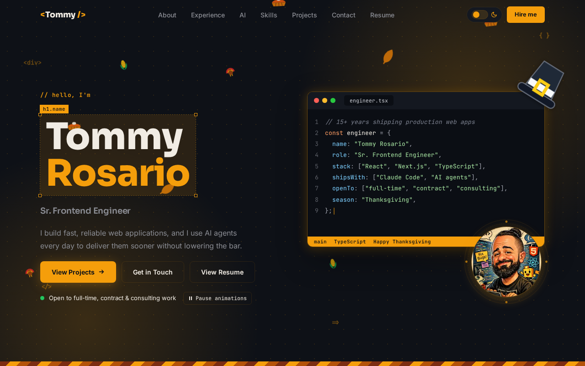

# Tommy Rosario Portfolio

[](https://github.com/tjrosario/portfolio/actions/workflows/ci.yml)

The source for [tommyrosario.me](https://tommyrosario.me), my portfolio as a senior frontend engineer. It's a single static page built with Next.js, React, TypeScript, and Tailwind CSS.



## Highlights

- **Seasonal theming:** the accent color, falling particles, and holiday art follow the date. A blocking script applies the theme before paint, so a static page still changes with the calendar and never flashes the wrong colors.
- **Accessibility:** audited against WCAG 2.2 AA. It has a skip link, a pause control for animations, reduced motion and forced colors support, and keyboard handling throughout the mobile menu and resume dialog.
- **Resume dialog:** a native `<dialog>` that fetches its content from `/api/resume` on first open, with loading and error states, and prints to a one-page PDF.
- **Search and AI discovery:** metadata, JSON-LD, a sitemap, a generated social image, and an `llms.txt` route, all built from one config file.
- **Light on dependencies:** four runtime packages and self-hosted variable fonts, with no state library because the site doesn't need one.

## Stack

Next.js 16 (App Router), React 19, TypeScript, Tailwind CSS 4, MSW, Vitest, Playwright, ESLint, Bun, and Vercel. GitHub Actions runs lint, both test suites, and a production build on every pull request.

## Run it locally

Requires [Bun](https://bun.sh) and Node 24.

```bash
bun install
bun run dev
```

Then open http://localhost:4000. To use another port, run `PORT=4500 bun run dev`.

| Command | What it does |
|---|---|
| `bun run dev` | Starts the dev server |
| `bun run build` | Creates a production build |
| `bun run start` | Serves the production build |
| `bun run lint` | Runs ESLint |
| `bun run test` | Runs the unit and component tests once |
| `bun run test:watch` | Runs those tests in watch mode |
| `bun run test:e2e` | Builds the site and runs the browser tests |

## Project structure

```
app/          Routes, layout, global styles, and the og, llms.txt, and api/resume routes
components/   Page sections and shared UI
data/         Experience timeline and resume content
docs/         README assets
e2e/          Playwright tests that run against the production build
lib/          Theme, season, motion, and resume state
mocks/        MSW handlers shared by local development and tests
public/       Fonts, icons, images, and the generated MSW service worker
test/         Vitest setup
site.config.ts   Site content, projects, skills, and seasons
```

## Testing

Unit and component tests use [Vitest](https://vitest.dev) and React Testing Library, and sit next to the code they cover. They share the MSW handlers from `mocks/`, so a test and the dev server get the same responses.

Browser tests use [Playwright](https://playwright.dev) against a production build. They cover axe scans of the page, resume, and mobile menu in every season and both themes, the resume loading, error, and print flows, keyboard navigation, the pause control, and season dates. Run `bunx playwright install chromium` once before the first run. The tests serve the build on port 4100, so that port must be free.

CI runs lint, both test suites, and the build on every pull request.

## API mocking

In development, [MSW](https://mswjs.io) intercepts `/api/resume` and adds a 1.2 second delay so the loading state is easy to see. Production skips MSW and uses the real route in `app/api/resume/route.ts`.

`public/mockServiceWorker.js` is generated, so run `bunx msw init public` after upgrading MSW.

## Editing content

| Content | Where it lives |
|---|---|
| Name, bio, skills, projects, links, seasons | `site.config.ts` |
| Experience timeline | `data/experience.json` |
| Resume dialog | `data/resume.json` |
| Season accent colors | `app/globals.css` |

## Previewing seasons

Seasons are checked in order and the first matching date range wins, so holidays sit above the seasons around them. To preview one, add `?season=<id>` to the URL, for example http://localhost:4000/?season=christmas.

Available ids: `christmas`, `newyear`, `valentines`, `stpatricks`, `fourth`, `halloween`, `thanksgiving`, `winter`, `spring`, `summer`, `fall`.

## AI tooling

I build with AI agents day to day. `AGENTS.md` and `CLAUDE.md` hold the instructions those agents read in this repo.

## License

The source code is available under the [MIT License](LICENSE). My name, likeness, images, biography, and resume and experience content aren't covered by it. All rights to those are reserved, so please replace them if you reuse this code.
